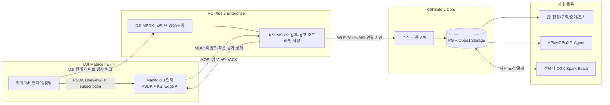

# 02. 시스템 아키텍처 — 물리, 논리, 흐름

상태: TARGET DESIGN, NOT VERIFIED. 아래의 `PSDK Edge`란 Manifold 3에서 실행하는 자체 KSI 프로그램으로, DJI 라이브러리 자체가 AI를 수행한다는 뜻이 아니다.

## 1. 물리 토폴로지



**금지 경로:** Manifold→KSI Core 직접 인터넷 업로드 / Manifold→실시간 GPU 서버→RC 경보 / RC→웹 라이브 스트리밍(기본). DJI 기체·RC 영상 전송은 MOP 명령/이벤트 전송과 다른 전송 경로다.

## 2. 논리 계층 및 Source of Truth

| 대상 | 신뢰/권위 Source | 보관 책임 | 비고 |
|---|---|---|---|
| 실시간 판단에 사용한 기체·짐벌 telemetry | Edge PSDK acquisition | Edge ephemeral→RC→server | MSDK telemetry는 UI용. 동일 판단에 혼합 금지 |
| DJI RC에 표시한 영상 | RC MSDK stream | RC low-bitrate recording | Edge 영상과 1:1 프레임 동일 가정 금지 |
| Edge AI inference frame | Edge PSDK stream | Edge 짧은 링버퍼/사건 snapshot | PSDK image frame_id는 DJI SDK 제공 범위 검증 필요 |
| 위험구역 기준 설정 | 서버 authoritative revision | 서버 immutable + RC/Edge copies | RC 오프라인 수정은 신규 tentative revision |
| '그 비행에서 사용한' 위험구역 | Mission Snapshot + Edge apply ACK | RC 및 서버 불변 보존 | 나중에 서버 최신판으로 덮어쓰기 금지 |
| 비행 중 조종사 의견 | RC 로컬 review_log | RC→server append-only | AI label 아님 |
| 최초 탐지와 증거 | Edge event + RC evidence manifest | RC outbox→server 영구 | hash 기반 evidence chain |
| 사후 VLM 제안 | Review Job output | 서버 versioned | 원본 detection을 덮어쓰지 않음 |
| 최종 검증된 평가 라벨 | Human adjudication | 분리된 dataset | Training opt-in, 검증을 거쳐야 함 |

## 3. 시간·정합을 담당하는 경계

### 3.1 time domains
- **PSDK_LOCAL_MONOTONIC:** Edge 내부 수신 event에 stamp; wall-clock 변경에 영향을 받지 않음.
- **PSDK_FC_TOPIC_TIMESTAMP:** DJI subscription에 따라 제공된 topic timestamp; 시간 기준/의미를 metadata로 보존, 노출 시각으로 가정 금지.
- **PSDK_FRAME_RECEIVE:** Liveview callback에서 받은 시각 + frame identifier 가능 시 기록.
- **RC_MONOTONIC:** RC 이벤트 수신·영상 프록시 시간축. Edge와의 추정 clock mapping은 후속 기능이고 즉시 동일시 금지.
- **SERVER_RECEIVED_UTC:** 서버의 업로드/저장 시각. 기체 촬영 시각의 대리인이 아님.

### 3.2 frame-to-telemetry contract
```
VideoFrame(frame_id?, edge_frame_recv_ns, lens_state, width, height)
PoseTopic(topic, source_sample_time?, edge_receive_ns, value, sequence?)
  -> Match(frame, topic samples, method, skew_ms, sample_age_ms, timing_uncertainty_ms)
  -> Observation(quality=valid | degraded | unknown, geometry_basis)
```

- 같은 sensor 값이라도 업데이트로 받은 실제 표본이면 사용 가능. 단, 캐시 읽기 시각만 바꿔 새 측정이라고 간주하지 않음.
- 서로 다른 topic은 측정 시각을 보존한 채 독립 매칭; 함께 묶어서 보내도 동시 측정이 되지 않음.
- time sync 기능/PPS 지원 자체가 카메라 실제 노출 시각 보장은 아님. time source와 오차 예산을 별도 측정.
- 정합 실패 시 이미지탐지는 `DETECTED_ONLY` 가능; GPS zone 확정/미터 거리 계산은 fail-closed.

## 4. 명령/이벤트 MOP 프로토콜 (제안)

### 4.1 채널
- `CONTROL_RELIABLE`: RC→Edge MISSION_PREPARE/APPLY/START/PAUSE/STOP/STATUS_QUERY, Edge→RC ACK.
- `EVENT_RELIABLE`: Edge→RC Observation/Incident/Health/Snapshot manifest 및 재전송.
- `EVIDENCE_TRANSFER`: Edge→RC 중요 snapshot/small clip, chunking/checksum. 지속 고화질 전체 영상을 이 채널로 복제하지 않음.
- `HEARTBEAT`: Edge state, capabilities, model version, thermal, free bytes, last sequence.

패킷 Header: `protocol_version`, `device_id`, `edge_boot_id`, `flight_id`, `mission_id`, `mission_revision_id`, `msg_id`, `seq`, `payload_sha256`, `ack_of`, `sent_monotonic_ns`. 변경될 수 있는 항목은 schema migration.

### 4.2 설정 적용 흐름
```
RC offline cache/edited draft
  → MISSION_PREPARE(config, schema_version, sha256)
Edge validate model/zone geometry/capability
  → PREPARED(hash, capability, exclusions)
RC confirms
  → MISSION_APPLY(hash)
Edge atomic swap config
  → APPLIED(hash, edge_boot_id, applied_seq)
RC enters AI READY (not merely SENT)
  → START_ANALYSIS → RUNNING ACK
```

중간 링크가 끊기면 RC는 `APPLIED` 없는 임무를 active라고 표시하지 않고, Edge는 마지막으로 ACK된 구성에서만 실행. 한 비행 중 설정을 변경한다면 새 snapshot을 만들고 Edge `applied_seq` 경계를 기록하여 사건별 적용 버전 추적.

### 4.3 결과 전달 흐름
```
Edge Observation event_id + event_seq + mission_hash
  → RC local WAL commit
  → RC ACK(event_seq)
  → Edge delivery spool eligible GC
```

RC 재연결 시 Edge `last_created_seq`, RC `last_durable_seq` 비교해 gap retransmission. 버퍼에서 사라진 gap은 `UNRECOVERABLE_GAP`로 비행 integrity 기록. ACK받은 후 Edge 데이터 정리 가능하나 영상/카메라 고화질 자료는 카메라 SD 정책 독립.

## 5. 영상 경로와 증거 계보

**두 영상이 있다.**
1. `live_rc_proxy` — DJI 링크에서 RC MSDK가 받는 화면 영상. 저용량 지속 기록(720p/15fps, 1~2 Mbps는 실험 출발값). 조종사 경험과 비행 전체 흔적을 남김. 무선 끊김 시 그 구간은 자료 없음.
2. `edge_inference_frame` — Manifold PSDK가 분석한 프레임. detector bbox/telemetry relation의 직접 근거. 사건 snapshot은 가능하면 해당 frame에서 만들고 `edge_frame_id`, `model_version`, `geometry_quality`를 결합.
3. `camera_sd_original` — DJI 카메라의 원본 기록(가능한 경우). 고정밀 재검증의 별도 원본. 자동 회수 여부는 G-09 물리 게이트.

RC 영상 위의 AI bbox는 정확한 frame alignment가 실증되기 전 `approximate_overlay` 또는 카드 알림으로만; 정확하다고 라벨링하는 행위 금지.

## 6. RC upload handshake (flight complete or policy permitted)
```
RC (offline WAL/manifest/files)     KSI Core
    | POST ingest session -------------->|
    |<-------------- upload_id, missing --|
    | chunks/objects idempotency key --->|
    |<---------------- per-object ACK -----|
    | POST complete (manifest hash) ---->|
    |<---------- DURABLY_COMMITTED + sha --|
    | RC marks SYNCED                    |
    | GC only after retention policy     |
```

서버 `DURABLY_COMMITTED`는 DB commit, Object Storage object readback/hash 및 manifest completeness 이후. 비행 일부 누락 시 `PARTIAL`을 별도 표현하고 정상 완료로 위장하지 않음. Android 재시작 시 work journal에서 이어감.

## 7. 위험구역 데이터 계보

- `site` → `work_area` → `zone` → `zone_revision`(immutable, WGS84 coordinates + semantic rule + valid interval + checksum).
- `mission_snapshot`은 여러 zone revision ID와 전체 내용/해시를 고정.
- `flight`은 `mission_snapshot_id + edge_applied_hash`와 실행 시각을 가짐.
- `observation/event`에는 `zone_revision_id`, `projection_method`, `position_uncertainty`, `frame_id`, `telemetry_source`.
- 온라인/오프라인 수정 충돌 시 `base_revision` 비교, 서버가 자동 merge하지 않고 새 candidate branch로 저장하여 검토.

## 8. 현장 안전/비행 제어 경계

PSDK AI는 경보/관측만 수행하고 드론 비행 제어 권한은 RC + DJI MSDK의 비행 제어 기능에 둔다. KSI가 DJI 자체의 RTH·장애물 회피·기체 안전 제한·조종사 판단을 대체하지 않음. 임무 설정의 '위험구역'은 AI 분석 Polygon이며 항공 비행금지구역과 다름.

## 9. 향후 adapter

`ObservationProducer` (PSDK Edge, 향후 RC local inference, 향후 Dock adapter) → 동일 서버 `Flight/Observation/Event/Evidence` 계약. Dock 경로는 단순히 'MOP=Dock'으로 치환 불가: 장비별 SDK/Cloud API와 증거 회수 가능 여부를 별도 검증해야 함.
