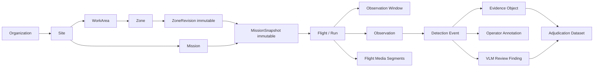

# 06. 데이터 모델 / 계약 / 계보

## 1. 가장 중요한 데이터 관계

## 2. UUID/식별자·시간 정책

- 모든 엔터티: `org_id, id(UUIDv7 권장 or UUIDv4), schema_version, created_at_utc, provenance.source_kind`.
- 현장 offline identifiers: `client_id` assigned on RC + `device_id` namespace. 온라인 등록 후 server canonical `id` 매핑 유지.
- 물리 edge continuity: `aircraft_id`, `manifold_id`, `edge_boot_id`, `rc_id`, `flight_id`, `session_id` 관계.
- 영상: `edge_frame_id`, `frame_seq`, `rc_proxy_segment_id`, `camera_lens_id`, `frame_size`; 서로 동일 frame 추정 금지.
- 시간: `edge_monotonic_ns`, `topic_source_timestamp`, `rc_monotonic_ns`, `server_received_utc`, `capture_time_estimate_utc?`, `time_uncertainty_ms`. no `timestamp` ambiguous.
- 비행 시각은 실제 측정/표시/업로드 시각을 분리. `flight_started_at`은 RC+기체 기록에 따라 provenance 명시.

## 3. 주요 Entity와 필수 필드

### Site / ZoneRevision
`site_id`, `work_area_id`, `zone_id`, `revision_id`, `parent_revision_id`, `geometry_wgs84`(GeoJSON polygon lon/lat), `rule_kind`, `rule_params`, `active_interval`, `authored_by`, `authored_device_id`, `content_sha256`.

- self-intersection/Coordinate winding validated; danger zone 유형과 실제 DJI geofence 별개.
- 수정은 새 revision을 발급. 과거 revision 불변. 삭제는 tombstone 새 revision.
- 웹/RC 오프라인 충돌: `expected_parent_revision_id` CAS; `409` 분기 생성.

### MissionSnapshot
`mission_id`, `mission_revision_id`, `site_id`, `zones[{zone_id,revision_id,sha256,polygon}]`, `detector_profile[{model_id,digest,enabled}]`, `evidence_policy`, `created_by`, `created_offline`, `content_sha256`. **기체 적용 ACK와 적용 시점은 snapshot 외부의 별도 `MissionApplication` 불변 기록으로 저장.**

### Flight
`flight_id`, `mission_snapshot_id`, `site_id`, `aircraft_id`, `rc_id`, `manifold_id`, `edge_boot_id`, `video_source`, `started/ended`, `upload_state`, `flight_completeness`, `ai_uptime_ratio`, `recording_gap_ms`, `zones_effective_intervals`.

### Observation
`observation_id`, `flight_id`, `edge_frame_id`, `edge_receive_monotonic_ns`, `telemetry_refs[{topic,sample_time,receive_time,age,source}]`, `model_digest`, `detections`, `sync_quality`, `geometry_basis`, `position_uncertainty`, `zone_revision_ids`, `evidence_ref`, `rejection_reasons`.

### DetectionEvent
`event_id`, `flight_id`, `observation_id`, `episode_id`, `event_type`, `detected_at_estimate`, `detection_severity`, `geo_verification`, `evidence_id`, `mission_snapshot_hash`, `zone_revision_id`, `initial_model_output` (immutable). `model_confidence`와 `observation_quality` 분리.

### EvidenceObject
`artifact_id`, `event_id?`, `flight_id`, `source_kind = EDGE_SNAPSHOT | EDGE_CLIP | RC_PROXY_SEGMENT | CAMERA_SD_ORIGINAL | LOG | TELEMETRY_SAMPLE`, `content_sha256`, `size`, `media_type`, `codec`, `capture_timebase`, `segment_start/end`, `upload_state`, `storage_uri_internal`, `retention_class`, `manifest_sha256`.

### Annotation / ReviewFinding
`annotation_id`, `target_event_id`, `author_id`, `assertion = FALSE_POSITIVE_SUSPECTED | NEEDS_REVIEW | REVOKE_PREVIOUS`, `comment?`, `created_locally_at`, `server_received_at`, `based_on_evidence_ids`, `supersedes_annotation_id?`.

VLM `finding_id`, `job_id`, `model_id/checksum`, `prompt_version`, `evidence_window`, `finding_type = FP_CANDIDATE | FN_CANDIDATE | UNCERTAIN | NO_ISSUE_FOUND`, `rationale`, `confidence_calibration?`, `human_adjudication_status = UNREVIEWED`.

### Coverage Window
`flight_id`, `time_start/end`, `camera_lens_id`, `view_polygon_wgs84?`, `view_quality = VALID | PARTIAL | UNKNOWN | NO_VIDEO`, `quality_reasons`, `map_basis`, `spatial_uncertainty_m`. 위험구역별 실제 관측은 valid coverage polygon의 누적과 교차로 추정하되, 가림이나 고도 때문에 PPE 식별 여부까지 확정하지 않음.

## 4. 좌표/시간 정합 원칙

- GeoJSON WGS84 `[longitude,latitude]` 순서, EPSG:4326 명시, 지면투영 계산은 ENU/ECEF 내부 사용 가능; 저장 시 변환 버전과 오차.
- 고도는 ellipsoid/mean sea level/above ground/relative-to-takeoff 혼합 금지. 미상이면 unknown.
- 기체 quaternion과 짐벌 yaw/pitch/roll은 coordinate frame/handedness 명시; SDK마다 기본 축 다를 수 있음.
- geometry calculation output: `origin`, `ray`, `surface_intersection`, `uncertainty`, `calibration_version`.
- `sync_quality`: `VALID`, `DEGRADED`, `UNKNOWN`, `INVALID`이며 숫자 `confidence`와 혼동 금지.
- 각 topic의 sensor timestamp가 없거나 신뢰성 확인 안 된 경우 `timestamp_basis=PSDK_LOCAL_RECEIVE`, 실제 센서 측정 시간이라고 표시하지 않음.

## 5. 모델 정답/검토 분리

- 최초 Edge AI 판단 = `raw_detection` / immutable.
- 조종사 의심 표시 = `operator_annotation` / 관찰자의 의견.
- VLM 분석 = `review_finding` / 모델의 제안.
- 학습 GT = `adjudication` / 정답 근거+독립 사람이 확인 후 `training_eligible=true`.
- 오탐 의심 표시만으로 원본 사건/증거를 삭제, 숨김 제외한 본래 데이터 수정, 모델 재학습 정답 사용 금지.

## 6. 검증 가능한 파일 계약

아래 JSON Schema는 제품 구현 출발점이며 현재 서버의 배포된 계약은 아니다.
- `contracts/schemas/mission-snapshot.v1.schema.json`
- `contracts/schemas/observation.v1.schema.json`
- `contracts/schemas/flight-upload-manifest.v1.schema.json`
- `contracts/schemas/operator-annotation.v1.schema.json`
- `contracts/schemas/review-finding.v1.schema.json`

샘플 payload는 `examples/`에 포함. API가 스키마를 검증하고 예전 버전은 명시적으로 migrate한다. 알 수 없는 `schema_version`을 묵시적으로 수용하지 않는다.

## v1.1 Spatial 관계 확장 (additive)
기존 Observation v1은 변경하지 않는다. `spatial-relation.v1` (사람/장비 관계와 거리 품질), `spatial-summary.v1` (비행·frame 연결을 포함한 집계), `risk-policy.v1` (해시/모드/임계치/구역) 별도 엔터티로 저장. 설명: `14~19` 문서. `METRIC_VERIFIED`와 `UNAVAILABLE`은 서로 다른 스키마 상태이며 거리 없는 경우 숫자를 쓰지 않는다.
