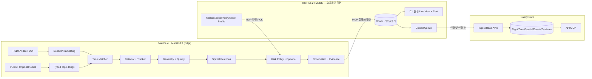

# 14. Spatial Observation Runtime Architecture

## A. 통신 경계 및 단일 책임

**주의:** RC의 라이브 화면은 DJI 링크이고 Edge의 PSDK 프레임은 추론 입력이다. frame ID/timestamp가 자동으로 동일하지 않다. Edge overlay는 충분히 검증한 경우만 좌표 일치로 표현하며 불가하면 독립 경고/Edge 스냅샷을 노출한다.

## B. 소프트웨어 모듈/프로세스
| Edge 책임 | 입력→출력 | 실패 시 결과 |
|---|---|---|
| `psdk_capture` | Liveview/FC topics/camera state → immutable frames + samples | source unavailable 진단, AI 분석 불가 표시 |
| `time_matcher` | frame + typed rings → matched inputs with provenance | cached/stale/future sample 방지, `UNKNOWN` |
| `perception` | 선택된 프레임 → person/equipment/PPE detections | 일부 모델 장애와 전체 중단 구분 |
| `tracker` | detections + camera motion → scoped track IDs | session reset/lens switch 시 lineage reset |
| `geo_engine` | footpoint/footprint + pose + calibrated lens + ground → 2D ENU geometry | verified metric 없으면 null |
| `relation_engine` | 유효 사람/장비 pairs + zones → distance interval, zone results | candidate only/undetermined |
| `risk_engine` | relations + policies + time continuity → Shadow or Active events | conflicting version/quality면 Active 0 |
| `evidence_packager` | event + Edge snapshot + metrics → bounded ring/spool | evidence gaps와 경고 분리 기록 |
| `mop_transport` | commands, ACK, sequenced events, chunked snapshots | retry/dedup/resume, 제어 트래픽 우선 |
| `health` | FPS/queue/memory/temp/clock/model → status | degraded profile + coverage gap |

## C. 선택적 스케줄링 (P0)
- 하나의 video decode/frame queue, person/equipment 공통 detection path를 우선. 여러 개의 고가 모델을 중복 실행하지 않음.
- Baseline은 `person+equipment` detector → tracker → cheap spatial candidate → geometry for candidate pair only. PPE는 인력 crop 품질·연산 예산·현장 임무의 활성 정책에 따라 낮은 빈도로 수행.
- 각 프레임 모든 객체쌍 O(N*M) 검증은 금지: class/zone/scene-broad-phase로 후보를 제한, near-neighbor만 상세 계산.
- drop 가능한 프레임은 inference queue에서만 oldest/latest policy로 처리하고, **전송한 사건·증거 파일·MOP control은 자동 유실하지 않는다**.
- 경고 생성 시 사용하는 이미지는 처리한 Edge frame과 `observation_id`에 정확히 연결. RC proxy 영상 frame과 혼동 금지.

## D. 시스템 모드
- `OFF`: 계측만/모델 비활성; 위험 경고 없음.
- `SHADOW`: 모델/위험 rules 계산하되 실제 사건 경고(Active write) 없음; 샘플·평가용 원본 구조화 기록.
- `ACTIVE`: 단일 위험 규칙에 한해 독립 물리 Gate 완료 및 운영자 승인 후 허용. sensor degraded시 우회적으로 강제 Active 불가.
- Edge↔RC MOP 분리 시 Edge는 로컬 bounded 이벤트 임시 보관, RC는 사용자가 통신 미확인 상태임을 표시. 제어권은 RC/DJI 비행 기능이 소유.

## E. 데이터 흐름 예외
- Risk policy 변경 중: 사전 검증→ atomic `APPLIED` ACK→`effective_edge_seq` 부여. 이전 사건은 옛 revision을 참조.
- AI 모델/PSDK 프로세스 재시작: `edge_boot_id` 변경, tracker/episode 일부 무효화 및 RC가 재연결·재동기화. 예전 ACK 재사용 금지.
- Manifold→RC 출력: high-priority `health, event, manifest`와 low-priority `snapshots`로 별도 bounded 큐. 네트워크 직접 업로드 코드 불필요.
- `screening`, `matching`, `geometry`의 불신 사유는 별도 enum reason으로 기록하고 후단에서 지워버리지 않음.

## F. 현재 미확인 근거
- DJI 공식 PSDK Matrice 4 + Manifold3 Linux Liveview 지원과 FC data subscription은 문서로 확인 가능. 실제 SDK/펌웨어/렌즈별 이용 가능성과 딜레이는 기체 실험 필수.
- DJI Liveview AI 결과를 Pilot에 렌더링하는 공식 기능은 Matrice 400 + H30 + Manifold3 지원 범위로 제한됨. RC KSI MSDK 자체 뷰 구현 필요.
