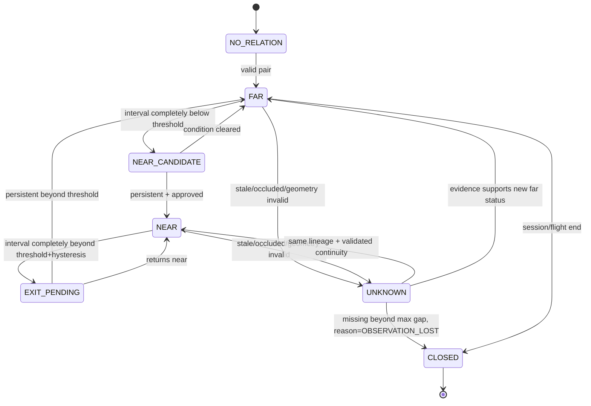

# 17. Risk Policy + Episode / Evidence

## 1. 계층 구분
- `Detection`: 영상에 사람/장비가 있는지.
- `Spatial Relation`: 두 객체 간 거리 구간, 구역 포함 상태, 접근 추세 및 계산 품질.
- `Risk Evaluation`: 어떤 정책(`rule_id`, `policy_sha256`, `zone_revision`)을 적용했을 때 결과.
- `Incident/Alert`: Shadow/Active mode, episode 상태, 사람에게 통지/증거.

임무 설정에는 **탐지 여부와 경고 정책을 따로 둔다**. 예: excavator detection ON, proximity rule SHADOW, zone_intrusion rule ACTIVE (이전에 별도 검증이 끝난 경우만 가능).

## 2. 정책 필드
`policy_id`, `revision_id`, `sha256`, `scope_site_id`, `rules[{rule_id,kind,mode,scope_classes,zone_revision_ids,threshold_m?,hysteresis_m?,enter_duration_ms,exit_duration_ms,required_geometry_level,required_calibration_id?,evidence_profile}]`, `effective_edge_seq`.

초기 proximity threshold는 **예시/실험값만** 제공하고 실제 적용은 현장·장비·법령/안전관리계획 검토 후 설정. `threshold_m=3` 같은 전국 공통 하드코딩은 금지.

## 3. Pair episode 상태

- Risk event는 `NEAR` 진입 시 `episode_id`로 한 번만 생성. 동일 episode 연속 프레임은 `TOUCH`/증거 누적만; 이탈은 `EXIT_CONFIRMED`가 관측된 경우만. 구간 유실 종료는 `OBSERVATION_LOST`로 별도 명시.
- 임시 Shadow 결과와 실제 운영 사건 결과는 별도 논리/DB 쓰기 경로. 승인되지 않은 위험 룰은 Active events/알림 0.
- `UNKNOWN` 상태에서 오래 기다리다가 자동 '안전'으로 종료하는 행위 금지.

## 4. Zone intrusion
- Polygon geometry WGS84 현재 `zone_revision`에서 사람/장비의 **추정 지면 footprint**와 교차.
- 위치 불확실성 envelope가 구역 경계를 걸치면 `BOUNDARY_UNCERTAIN`, 내부/외부 확정 금지.
- Zone 유형 `no_entry`, `work_area`, `equipment_buffer` 등. 위험구역 자체가 임무-비행에 적용된 버전이어야 하며 웹의 '현재 최신'을 과거 사건에 덮지 않는다.
- DJI 조종/비행금지구역과 KSI 안전 폴리곤은 별도의 개념.

## 5. MSDK가 보여주는 것
- 라이브 조종 뷰: 원본 DJI 영상 + Edge 경고 상태. overlay 실기 frame map 검증 전엔 해당 Edge snapshot을 팝업에 사용.
- 이벤트: `위험 후보/확인 필요/오탐 의심` 의견 버튼은 선택적. **모든 감지에 승인을 강제하지 않음**.
- 증거 보기: `Edge original detection`/`operator annotation`/`nightly VLM finding` 분리 탭; 원본 삭제/덮어쓰기 금지.
- 업로드: local first; 비행 종료 후 Wi-Fi 등 연결 시 자동 sync; 서버 durable ACK 뒤 로컬 GC.

## 6. VLM/LLM 사후 감사
- 온라인 실시간 경보에는 참여하지 않음.
- 비행/클립 업로드 후 표본 감사 + 오탐·미탐 후보만 등록. VLM 결과는 `AI_REVIEW_SUGGESTION`, 사람 검증 정답은 `ADJUDICATION`으로 분리.
- RC 운영자의 '오탐 의심'은 모델 재학습 정답이 아니라 큐 우선순위와 라벨링 후보 신호.
