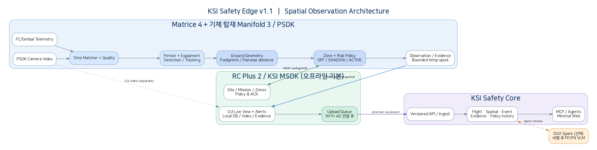
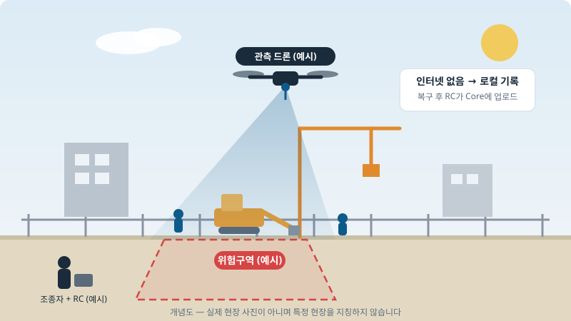
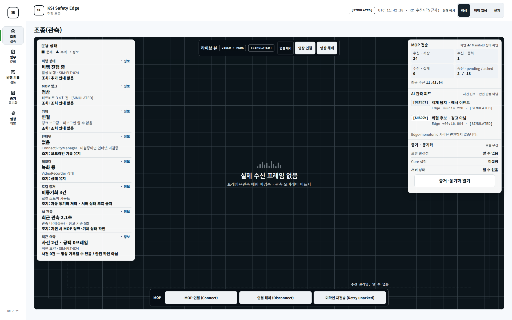
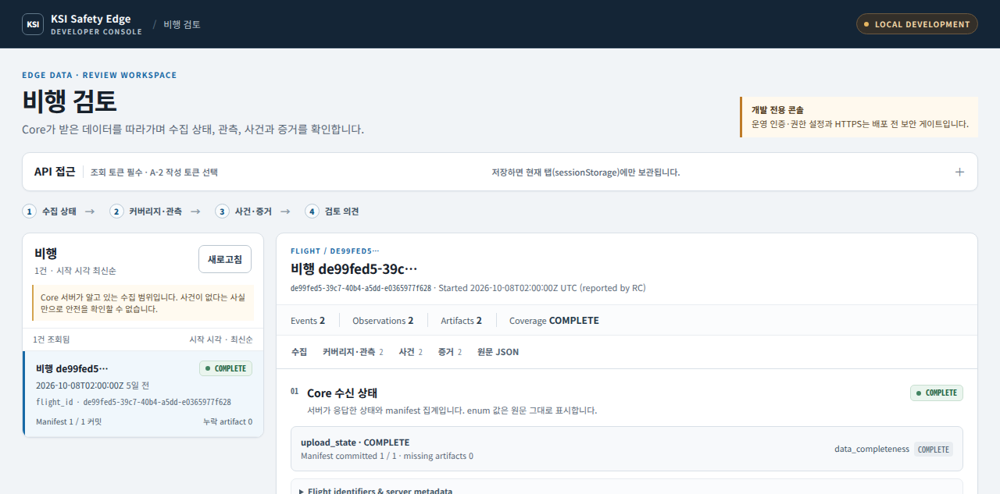
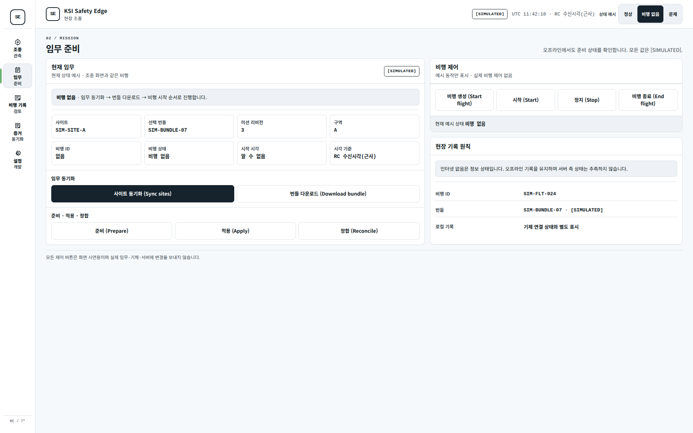
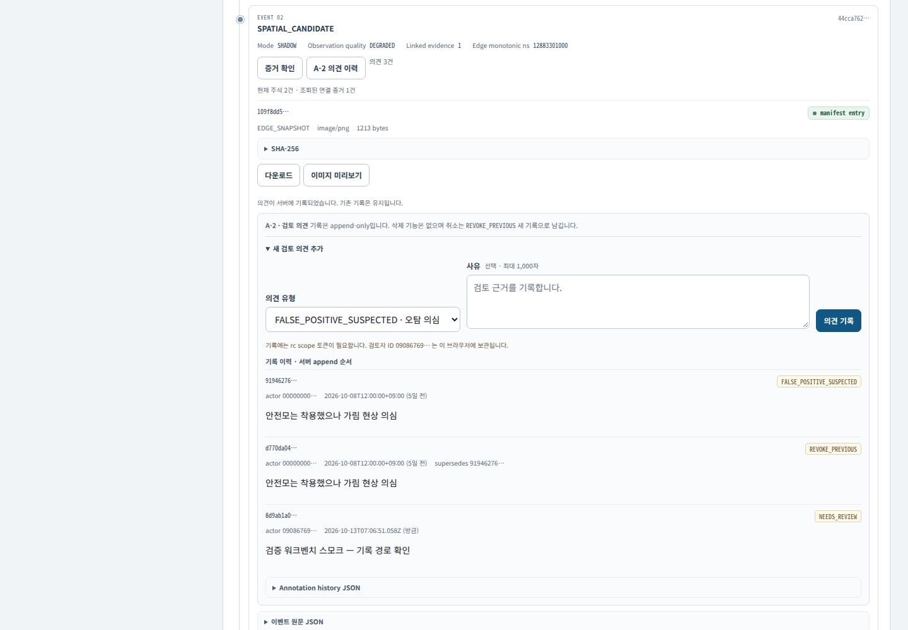
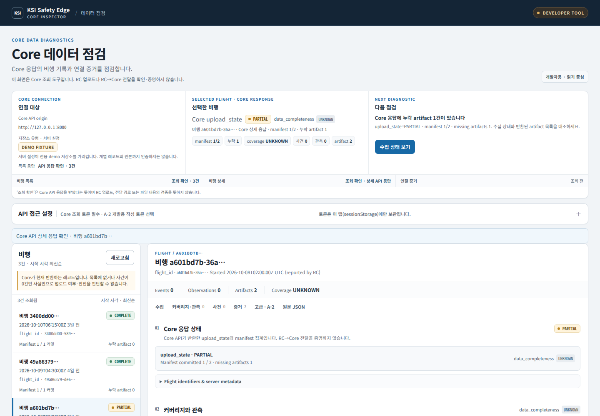

# KSI Safety Edge — 오프라인 우선 드론 안전 관측 시스템

[](https://github.com/khakisketch/KSI-Safety-edge/actions/workflows/ci.yml)


> 인터넷이 없어도 현장에서 사람·중장비를 관측·기록하고,
> 연결 복구 후 **당시의 설정과 증거를 그대로 재현**하는 드론 기반 안전 관측 시스템입니다.

📄 **제품 소개 페이지: https://khakisketch.github.io/KSI-Safety-edge/**

**개발: 주식회사 케이에스아이 ｜ 문의: 043-288-4860**

---

## 제품 상태 (공개 시점 기준)

| 구분 | 상태 |
|---|---|
| 재생 시나리오 검증 (E01~E12) | 재생 환경에서 확인 — 사용자 인수 미실시 |
| 실제 기체·RC 검증 | 진행 중 (실기 검증 전) |
| 운영 배포 (인증·권한·HTTPS) | 보안 게이트 준비 전 |

- 해결하려는 문제: 네트워크가 없는 현장에서도 사람·중장비 관측 기록이 끊기지 않고, 연결 복구 후 당시 설정과 증거를 그대로 조회할 수 있어야 합니다.
- 현재 확인된 근거: 재생 하네스에서 `임무 적용 → 오프라인 기록 → 재시작 복원 → 업로드 → 조회` 전 구간과 장애 시나리오(E01~E12)를 재현합니다. Python·C++·Android 3축 CI가 `main` 푸시마다 실행됩니다.
- 현장 적용 전 남은 것: 실제 기체·RC 실기 검증, 사용자 인수, 운영 인증·권한·HTTPS 게이트입니다.

---

## 한눈에 보기

| 구성 | 역할 | 기술 |
|---|---|---|
| **Edge (기체 탑재)** | Matrice 4 + Manifold 3, 사람·중장비 탐지·추적·공간 분석 | C++ (PSDK), ONNX / TensorRT |
| **RC (조종기)** | 오프라인 기록·미션 적용·복구 후 업로드 | Android (MSDK), Kotlin, append-only 로그·증거 파일 |
| **Core (서버)** | 증거 수집·데이터 점검·의견 기록(개발·검증용) | Python FastAPI, SQLite / 파일 오브젝트 저장 |



- Edge → 서버 직접 업로드 없음. **RC가 유일한 업로드 주체** (오프라인 우선 원칙)
- 공간 판단은 **SHADOW(참고 표시)** 가 기본. 자동 경고(ACTIVE)는 검증된 규칙에서만 허용
- “사건 0건 ≠ 안전” — 관측 공백(커버리지·품질 사유)을 함께 표시하는 정직 표기

## 설계된 현장 운용 흐름

> 아래는 설계된 운용 흐름(목표 동작)입니다. RC→Core 전송의 종단간 검증은 별도 절차이며,
> 실기 검증·사용자 인수 전입니다.

```
① 비행 전 준비 (RC) → ② 비행 중 오프라인 관측·기록 (Edge+RC)
→ ③ 연결 복구 후 업로드 (RC→Core) → ④ 데이터 점검 (Core 웹)
```

1. **임무 준비** — 사이트·미션 번들·구역 정책을 RC에 동기화하고 Edge에 적용합니다.
2. **비행 관측** — 네트워크 없이도 탐지·추적·공간 관측을 수행하고 RC 로컬 DB에 영속 기록합니다.
3. **증거 동기화** — Wi-Fi/4G 복구 후 업로드 큐가 재개·중복방지·무결성 검증과 함께 Core에 전송합니다.
4. **데이터 점검** — 업로드 상태·관측 커버리지·사건별 근거·증거 원본을 조회합니다 (설계된 흐름이며 운영자 검토 서비스는 별개입니다).

## 현장 적용 시나리오 (예시)

> 아래는 이해를 돕기 위한 **가상 시나리오와 개념도**입니다. 특정 실현장을 지칭하지 않으며, 실기 검증·사용자 인수 전입니다.



| 시간 | 장면 | 시스템 동작 |
|---|---|---|
| 08:00 | 조회에서 당일 임무 확인 | 사이트·미션 번들·구역 정책을 RC에 동기화 |
| 09:00 | 드론 이륙, 음영 구간 진입 | 인터넷 없이 Edge 관측 + RC 로컬 영속 기록 |
| 09:20 | 중장비 인근 작업자 접근 (가상) | SHADOW 참고 표시로 기록, 자동 경고 없음 |
| 10:00 | 귀환 후 네트워크 복구 | RC 업로드 큐가 재개·검증과 함께 Core 전송 |
| 11:00 | 사무실에서 당일 비행 확인 | 수집 상태·커버리지·사건·증거 조회, 의견 기록 |

### 투입 장비 구성

| 장비 | 역할 |
|---|---|
| Matrice 4 (기체) | 비행 플랫폼 |
| Manifold 3 (기체 탑재) | Edge 관측 연산 (탐지·추적·공간 분석) |
| RC Plus 2 (조종기) | RC 앱 — 오프라인 기록·미션 적용·업로드 |

## 화면 소개 (시연 화면)

> 아래 화면은 시연 환경 캡처이며, 화면 우측 상단의 `[SIMULATED]` 표기를 유지합니다.
> 현장명은 예시(`SIM-FLT-024` 등)이며 특정 실현장을 지칭하지 않습니다.

### RC 조종(관측) — 영상과 기록 상태 중심의 보조 화면



- 위 이미지는 이전 시연 배치입니다. 현재 RC 정본은 `design/rc-pilot-shell/field-shell.html`과 Android 앱입니다.
- 현재 메인은 영상·출처별 상태 띠를 중심으로 표시하며, 연결·저장 실패와 미수신을 구별합니다. 비행 조종 기준은 **DJI Pilot 2**입니다.
- AI 사건 상세는 비행 후 기록에서 검토합니다. `[DETECTED_ONLY]`/`[SHADOW]`는 관측/후보 기록이며 안전 확인이나 경고가 아닙니다.
- 영상 프레임 매핑 검증 전에는 박스를 표시하지 않습니다. 영상 입력 수신·실제 화면 표시·증거 저장 성공도 각각 별도로 확인합니다.

### Core 데이터 점검 — 개발자용 시연 화면 (운영자 검토 아님)



- Core API가 반환하는 `upload_state`·`COMPLETE/PARTIAL`·커버리지·사건 수·증거 수를 그대로 보여주는 개발자 진단 화면입니다.
- RC 업로드를 실행하거나 RC→Core 전달을 증명하지 않으며, 운영자용 검토 서비스와는 별개입니다.

<details>
<summary>더 보기: 임무 준비 · A-2 의견 기록 · 증거 응답 조회</summary>

### RC 임무 준비 — 오프라인에서도 준비 상태 확인, 예시 동작만 표시



- 사이트 동기화·번들 다운로드·준비/적용/정합(예시 동작이며 실제 임무·기체·서버에 변경을 보내지 않음)

### A-2 의견 기록 — 개발·검증용 쓰기 경로 (운영 검토 아님)



- 의견 유형(오탐 의심·재검토 필요 등) + 사유 기록, 정정은 `REVOKE_PREVIOUS` 새 기록으로만 가능합니다.
- 주의: 기록 시 연결된 Core에 실제 append-only 레코드가 추가됩니다. 운영자의 안전 검토 행위를 뜻하지 않습니다.

### 증거 응답 조회 — Core API 반환 확인



- 사건 참조 ID와 Core `/evidence`·`/objects` API 응답이 맞는지 조회·대조하는 화면입니다.
- SHA-256·manifest 기준 검증 결과를 표시하며, 파일 내용·출처의 육안 확인을 대신하지 않습니다.

</details>

## 기술적 특징

- **계약 우선 설계**: JSON Schema 13종 + OpenAPI 40여 개 오퍼레이션으로 Edge/RC/Core 경계를 고정하고, Python·C++·Kotlin이 동일 계약으로 검증됩니다.
- **결정적 재생 하네스**: 장비 없이 `임무 적용 → 오프라인 기록 → 재시작 복원 → 업로드 → 조회` 전 구간과 장애(E01~E12: ACK 유실·중복·역순·중단재개·손상정정·교차조직 차단 등)를 재현합니다.
- **3축 CI**: 모든 `main` 푸시마다 Python(contracts·core·harness) + Edge C++ 빌드/테스트 + Android 단위테스트·벤치 APK를 검증합니다.
- **무결성 보장**: 멱등 ingest·digest 검증·감사 로그·교차 조직 접근 시 존재 여부 비노출(404) 원칙.

## 저장소 구성

| 경로 | 내용 |
|---|---|
| `AGENTS.md` | 개발 정본 진입 안내(문서 지도) — 현행/과거/보존 구분 |
| `contracts/` | JSON Schema·OpenAPI·계약 정책 (경계의 기준본) |
| `libs/ksi_contracts/` | canonical digest·도메인 검증 공용 패키지 |
| `edge/` | 기체 탑재 관측 코어 (C++) |
| `android-rc/` | RC 앱 (MSDK 셸·로컬 저장·업로드) |
| `core/` | 서버 API + 데이터 점검 웹 콘솔 (개발자용) |
| `harness/` | 재생·시뮬레이터·장애 주입·E2E 시험 |
| `design/` | 화면 캡처·설계 기록 (포트폴리오 이미지 출처) |
| `docs/` | ADR·계획·검증 기록 |

## 빠른 시작 (개발용)

```bash
bash scripts/setup_env.sh        # .venv 생성 + 패키지 설치
source .venv/bin/activate
bash scripts/run_all_tests.sh    # Python 테스트 전체 (contracts·libs·core·harness)

# Core 서버 실행 예시
KSI_DB_URL="sqlite:///$(pwd)/core/var/ksi_core.db" \
KSI_OBJECT_ROOT="$(pwd)/core/var/objects" \
  python -m uvicorn ksi_core.app:create_app --factory --port 8000
```

- 검토 콘솔: `GET /review` (정적 화면, 조회는 기존 읽기 API만 호출; A-2 의견 기록은 별도 개발·검증용 쓰기 경로이며 기록 시 서버 데이터가 실제로 변경됩니다)
- 운영 배포 전 인증·권한·HTTPS는 별도 보안 게이트가 필요합니다.

## 문의

- **주식회사 케이에스아이 (KSI Corporation)**
- **전화: 043-288-4860**
- 제품 도입·시연·기술 문의는 전화로 연락해 주세요.
